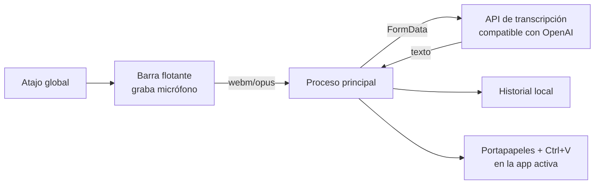

# VoiceFlow

> Dictado por voz con atajo global: pulsas una combinación en cualquier app, hablas, y
> el texto transcrito se escribe solo en la aplicación que tenías enfocada.

Reimplementación **educativa y de código abierto** de la app de escritorio
[Typeless](https://www.typeless.com) (v2.10.0), reconstruida a partir del análisis de su
arquitectura. Reproduce el flujo de cliente —atajo global, barra flotante, captura de
micrófono, transcripción e inserción en la app activa— con una interfaz *liquid glass* y
tipografía de terminal.

Pensada para aprender cómo se construye una utilidad de dictado sobre Electron. El backend
propietario y la librería nativa del original **no** se incluyen ni se redistribuyen; se
sustituyen por alternativas abiertas y estándar.

---

## ✨ Características

- 🎙️ **Atajo global de dictado** — funciona aunque la app no tenga el foco.
- 🫧 **Barra flotante** translúcida que no roba el foco a la app donde escribes.
- 🧠 **Transcripción** vía cualquier endpoint compatible con la API de OpenAI
  (`gpt-4o-mini-transcribe` en la nube, o un servidor local gratuito como `whisper.cpp` /
  `faster-whisper`).
- 🧹 **Limpieza automática del texto** — quita muletillas y, si dictaste una frase y te
  corregiste a mitad de camino, se queda solo con la versión final que quisiste decir.
- 🤫 **Auto-stop por silencio** y descarte de grabaciones vacías (evita transcripciones
  "alucinadas" de un clip sin audio real).
- ⌨️ **Inserción automática** del texto en la aplicación activa (portapapeles + pegado).
- 📋 **Pegar la última transcripción** con un segundo atajo.
- 🗂️ **Historial local** persistente; clic en una entrada para re-insertarla.
- ⚙️ **Panel de ajustes** para API key, atajos, idioma, micrófono y modo de inserción —
  no hace falta tocar `.env` ni la terminal.
- 💾 **Instalador para Windows** con arranque automático al iniciar sesión.
- 🌐 **Multi-idioma** — autodetección o idioma fijo (ISO 639-1).
- 🔒 **Privado por defecto** — el audio solo viaja al endpoint de transcripción que tú
  configures; el historial se guarda en tu disco.

## 🎬 Cómo funciona



1. Pulsas el atajo → aparece la barra flotante y empieza a grabar (`getUserMedia` +
   `MediaRecorder`, códec Opus).
2. Al parar, el audio va al proceso principal por IPC.
3. El proceso principal lo envía como `multipart/form-data` al endpoint de transcripción.
4. El texto resultante se guarda en el historial y se inserta en la app que tenías
   enfocada (copia al portapapeles y simula `Ctrl+V`).

## 🧱 Stack

| Capa | Tecnología |
|------|-----------|
| Runtime | [Electron](https://www.electronjs.org/) 33 |
| Atajos globales | `globalShortcut` de Electron |
| Audio | `getUserMedia` + `MediaRecorder` (WebM/Opus) |
| Transcripción | API compatible con OpenAI (`fetch`/`FormData` nativos de Node 22) |
| Inserción de texto | Portapapeles de Electron + `SendKeys` de PowerShell |
| Persistencia | Archivo JSON en el directorio de datos del usuario |

Sin dependencias nativas que compilar: la única dependencia es Electron.

## 📋 Requisitos

- **Node.js ≥ 22** (incluye `fetch`, `FormData` y `Blob` globales).
- **Windows 10/11** — la inserción de texto usa `SendKeys` de PowerShell.
- Una **clave de API** de transcripción (OpenAI u otro endpoint compatible), **o** un
  servidor local de Whisper.

## 🚀 Instalación

**Opción fácil (recomendada para no-técnicos):** descarga el instalador `.exe` desde los
[Releases](../../releases) del repositorio, ejecútalo y pega tu API key en el panel de
Ajustes la primera vez que abras la app. Queda instalada y arranca sola al iniciar sesión.

**Desde el código fuente:**

```bash
git clone https://github.com/<tu-usuario>/voiceflow.git
cd voiceflow
npm install
```

## ⚙️ Configuración

Copia la plantilla de entorno y rellena tu clave:

```bash
cp .env.example .env
```

```ini
# .env
VOICEFLOW_API_KEY=sk-...                                          # obligatoria
VOICEFLOW_API_URL=https://api.openai.com/v1/audio/transcriptions  # opcional
VOICEFLOW_MODEL=gpt-4o-mini-transcribe                             # opcional
VOICEFLOW_TEXT_MODEL=gpt-4o-mini                                   # opcional
```

| Variable | Obligatoria | Por defecto | Descripción |
|----------|:-----------:|-------------|-------------|
| `VOICEFLOW_API_KEY` | ❌* | — | Clave del endpoint de transcripción y limpieza (o usa `OPENAI_API_KEY`). *Solo si no la pegaste en el panel de Ajustes. |
| `VOICEFLOW_API_URL` | ❌ | `https://api.openai.com/v1/audio/transcriptions` | Endpoint de transcripción. |
| `VOICEFLOW_MODEL` | ❌ | `gpt-4o-mini-transcribe` | Modelo de transcripción. |
| `VOICEFLOW_TEXT_MODEL` | ❌ | `gpt-4o-mini` | Modelo de texto usado para limpiar muletillas y frases reiniciadas. Si falla o no hay API key, se usa un filtro local sin red. |

> **Nunca** subas tu `.env` al repositorio: ya está en `.gitignore`.

### Usar un servidor local gratuito (sin coste de API)

Levanta un servidor compatible con la API de OpenAI, por ejemplo
[`faster-whisper-server`](https://github.com/fedirz/faster-whisper-server) o
[`whisper.cpp`](https://github.com/ggerganov/whisper.cpp) en modo servidor, y apunta:

```ini
VOICEFLOW_API_URL=http://localhost:8000/v1/audio/transcriptions
VOICEFLOW_API_KEY=sk-local   # cualquier valor no vacío si el servidor no valida
```

## ▶️ Uso

```bash
npm start
```

| Acción | Atajo (por defecto) |
|--------|---------------------|
| Iniciar / detener dictado | `Ctrl + Shift + Space` |
| Pegar la última transcripción | `Ctrl + Shift + V` |

1. Pon el cursor en cualquier campo de texto (Word, navegador, chat…).
2. Pulsa el atajo de dictado, habla y vuelve a pulsarlo.
3. El texto aparece en el campo enfocado y queda guardado en el historial.

Los atajos, el idioma y el modo de inserción se cambian en el panel (ventana
**VoiceFlow**).

## 📦 Empaquetar para distribuir

El proyecto arranca en modo desarrollo con `npm start`. Para generar el instalador
(`dist/VoiceFlow Setup <versión>.exe`), ya incluye [`electron-builder`](https://www.electron.build/):

```bash
npm run dist
```

## 🗂️ Estructura del proyecto

```
voiceflow/
├── src/
│   ├── main.js          # Proceso principal: ventanas, atajos, IPC, orquestación
│   ├── preload.js       # Puente contextBridge entre renderer y main
│   ├── env.js           # Carga del archivo .env (sin dependencias)
│   ├── store.js         # Persistencia de ajustes e historial (JSON)
│   ├── transcribe.js    # Llamada al endpoint de transcripción
│   ├── cleanup.js       # Limpia muletillas y frases reiniciadas en el texto transcrito
│   ├── paste.js         # Inserción de texto en la app activa
│   └── renderer/
│       ├── floating.html / floating.js  # Barra flotante de grabación
│       └── hub.html / hub.js            # Panel de ajustes e historial
├── .env.example
├── .gitignore
├── package.json
├── LICENSE
└── README.md
```

## ⚠️ Limitaciones conocidas

- **Solo Windows.** La inserción de texto depende de `SendKeys` de PowerShell. En otras
  plataformas habría que sustituir `src/paste.js`.
- **Modo "mantener para hablar" (push-to-talk) no disponible.** `globalShortcut` solo
  detecta la pulsación, no el *key-up*; el original usa un hook de teclado nativo. Aquí el
  modo operativo es *alternar*.
- **Pegado vía portapapeles.** Sobrescribe el portapapeles durante el pegado (se restaura
  en ~0,4 s) y puede fallar en apps que ignoren `Ctrl+V`.
- **No incluye** cuenta/login, onboarding ni sincronización de historial en la nube del
  original (requieren su backend propietario).

## 🤝 Contribuir

Las contribuciones son bienvenidas:

1. Haz un fork y crea una rama (`git checkout -b feature/mi-mejora`).
2. Haz tus cambios y pruébalos con `npm start`.
3. Abre un Pull Request describiendo el cambio.

Ideas de buen primer PR: soporte macOS/Linux para `paste.js`, push-to-talk real con un
hook nativo, indicador de progreso de transcripción, o exportar el historial.

## 📄 Aviso legal

Proyecto **educativo** e independiente. No está afiliado, patrocinado ni respaldado por
Typeless ni por sus creadores. "Typeless" es marca de sus respectivos titulares; se usa
aquí solo de forma descriptiva para indicar el proyecto de referencia. No se redistribuye
ningún código, binario, modelo ni activo del producto original.

## 📝 Licencia

[MIT](./LICENSE).
